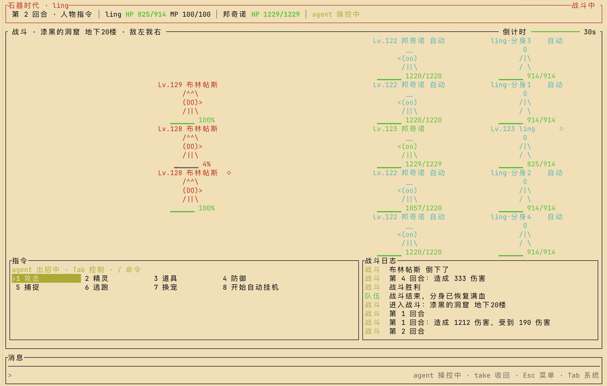

<div align="center">

# 石器时代 2.5 · 命令行版

**在终端里玩石器时代。** 装好一个程序，输入 `stoneage`，注册、建角色、进游戏。

[安装](#安装) · [开始游戏](#开始游戏) · [让 agent 帮你玩](#让-agent-帮你玩) · [升级](#升级) · [常见问题](#常见问题)



<sub>战斗界面：敌我双方、血量条、指令栏和战斗日志，全在终端里。</sub>

</div>

---

## 安装

找到你的系统，照着做三步就行，**装一次就够**。不需要先装别的软件。

支持：macOS（Apple 芯片和 Intel 都行）、Linux（x64）、Windows 10 / 11（x64）。

### macOS

1. **打开「终端」**：按 `⌘ + 空格`，输入「终端」或 `Terminal`，回车。
2. **复制下面这一行，粘贴进终端，回车**，等它显示安装完成：

   ```sh
   curl --proto '=https' --tlsv1.2 -LsSf https://github.com/athlan20/stoneage/releases/latest/download/stoneage-client-installer.sh | sh
   ```

3. **关掉这个终端窗口，重新打开一个**，输入 `stoneage` 回车，游戏就开始了。

> 用 Homebrew 的话，第 2 步也可以换成 `brew install athlan20/tap/stoneage`。

### Windows

1. **打开 PowerShell**：点开始菜单，输入 `PowerShell`，点「Windows PowerShell」。（装了 Windows Terminal 也可以直接用它。）
2. **复制下面这一行，粘贴进去（在窗口里点右键就是粘贴），回车**，等它显示安装完成：

   ```powershell
   powershell -ExecutionPolicy Bypass -c "irm https://github.com/athlan20/stoneage/releases/latest/download/stoneage-client-installer.ps1 | iex"
   ```

3. **关掉这个窗口，重新打开一个**，输入 `stoneage` 回车，游戏就开始了。

> 整行都要复制，开头的 `-ExecutionPolicy Bypass` 不能省：Windows 默认不允许运行脚本，加了它只对这一次生效，不会改你的系统设置。

<details>
<summary>想装到别的盘，或者不想改 PATH</summary>

默认装到 `%USERPROFILE%\.cargo\bin`，并自动加进 PATH。想换位置，在第 2 步**之前**先运行：

```powershell
$env:STONEAGE_CLIENT_INSTALL_DIR = "D:\games\stoneage"   # 程序会装在这个目录的 bin\ 下
$env:STONEAGE_CLIENT_NO_MODIFY_PATH = "1"                # 不改 PATH，之后用完整路径运行
```

</details>

### Linux

1. **打开终端**（大多数桌面按 `Ctrl + Alt + T`）。
2. **复制下面这一行，粘贴进终端，回车**：

   ```sh
   curl --proto '=https' --tlsv1.2 -LsSf https://github.com/athlan20/stoneage/releases/latest/download/stoneage-client-installer.sh | sh
   ```

3. **关掉终端重新打开**，输入 `stoneage` 回车。

### 其他安装方式

已经装了 Node.js 18 以上（任何系统都行）：

```sh
npm i -g stoneage-cli      # 安装，之后输入 stoneage 运行
npx stoneage-cli           # 或者不安装，直接试玩
```

---

## 开始游戏

```sh
stoneage
```

1. 终端窗口建议开到 **120 × 40** 以上，字体选等宽字体。
2. 第一次进入先注册账号，再创建角色，然后进入世界。
3. 默认连线上服务端，不用配置。

**最常用的几个键**

| 按键 | 作用 |
|---|---|
| `Esc` | 打开游戏菜单；在菜单里逐层退回 |
| `↑` `↓` `←` `→` | 选择对象、切换栏目 |
| `Enter` | 确认 / 打开动作 |
| `/` | 打开命令栏，输入命令 |
| `Ctrl+C` | 退出（会先确认，默认不退出） |

**常用启动参数**

| 参数 | 作用 |
|---|---|
| `--server 地址` | 连别的服务端，如 `--server 127.0.0.1:7065` 或 `--server wss://域名/ws` |
| `--account 账号` | 预先填好账号 |
| `--unicode false` | 终端显示乱码或方块时用，改用兼容性更好的细线和点阵字符 |
| `--reduce-motion` | 减少动画，适合刷新慢的终端 |
| `--no-update-check` | 启动时不检查新版本 |

---

## 让 agent 帮你玩

你平时用的 AI 编程助手（**Claude Code、Codex、OpenCode 之类都行**，下面统称 agent）可以直接来玩你的角色：练级、打怪、跑地图。做法很简单：**在游戏里输入 `agent`，把弹出的那段话粘贴给你的 agent**，剩下的它自己会做。

你自己可以同时在线，看着它玩、私聊给它下指令，随时把控制权收回来。agent 用的是游戏生成的**专用令牌**，不是你的密码：只能用来玩，不能改密码、不能建角色或删角色，随时可以作废。

### 三步接入

1. **在游戏里输入 `agent`**：进入世界后，按 `/` 打开命令栏，输入 `agent` 回车。
   消息栏会出现一段以「复制下面整段发给你的 agent」开头、「结束」结尾的话，里面带着令牌，**已经自动复制到剪贴板**。
2. **打开你的 agent，把这段话整段粘贴进去**，发送。可以在后面加一句你想让它做什么，比如「先练到 20 级」；不说的话它会自己找路线练级。
3. **回到游戏看它玩**。它上线后会私聊跟你打招呼、汇报计划。

> agent 会在你的电脑上下载并运行一个 Python 脚本来连游戏，所以那台电脑要有 Python 3（macOS 和大多数 Linux 自带）。Windows 上建议在 [WSL](https://learn.microsoft.com/zh-cn/windows/wsl/install) 里运行 agent，脚本用到的命名管道 Windows 原生不支持。

粘贴给 agent 的那段大概长这样（地址和令牌由游戏自动填好，不用改）：

```text
你是我的石器时代 agent。请先读手册 https://<服务器>/agent.md ，再下载参考脚本 https://<服务器>/agent-connect.py ，用它连接 wss://<服务器>/ws 并以 agent 身份登录，代我游玩。
令牌（只显示这一次，勿外传）：sat_……
启动示例：mkfifo agent.in
export STONEAGE_AGENT_TOKEN=sat_……
python3 agent-connect.py --url wss://<服务器>/ws --input agent.in > agent.out 2>&1 &
```

手册里写了 agent 该怎么连接、怎么打仗、什么事必须先问你（比如接受别人的组队邀请），你不用另外教它。

### agent 在玩的时候，你能做什么

都是在游戏里按 `/` 打开命令栏输入：

| 想做的事 | 输入 |
|---|---|
| 给 agent 发私聊（下指令、叫它停一下） | `ag 你的话` |
| 收回控制权，自己来操作 | `take` |
| 把控制权交还给 agent | `release` |
| 让 agent 立刻下线 | `kick-agent` |
| 看自己生成过哪些令牌 | `token list` |
| 作废某个令牌（agent 会被立刻断开，之后也登不上） | `revoke 编号` |

- agent 操控期间，你可以看背包、看地图、聊天，但**移动、战斗、用道具这类操作会被拦下**，提示你先 `take`。
- 收回控制权后 agent 只能旁观，等你 `release` 才会接着玩。
- 这些操作在游戏菜单的「系统」页里也有，按 `Esc` 打开菜单就能找到，不想记命令可以用方向键点。

### 关于令牌

- 令牌**只在生成时显示一次**，相当于你角色的一把钥匙，不要发到群里或公开的地方。
- 默认 30 天后失效，想改有效期可以输入 `agent 备注 天数`（1–365 天），例如 `agent 我的Claude 7`。
- 每个账号最多同时有 5 个有效令牌，用不上的用 `revoke` 作废掉。
- 担心泄露就直接 `revoke`，作废后马上失效，账号和密码不受影响。

---

## 升级

```sh
stoneage update
```

启动时如果发现新版本，底部消息栏会提示一行。`stoneage update` 会按你的安装方式处理：

| 安装方式 | 升级方式 |
|---|---|
| 一键脚本 | `stoneage update` 直接升级 |
| Homebrew | `brew upgrade stoneage` |
| npm | `npm update -g stoneage-cli` |
| cargo | 重新执行上面的 `cargo install` 命令 |

---

## 常见问题

**装完输入 `stoneage` 提示找不到命令？**
已经打开的终端不认识新装的程序，关掉终端重新开一个就好。

**Windows 运行安装命令报「禁止运行脚本」？**
用上面带 `-ExecutionPolicy Bypass` 的完整命令，不要只粘贴后半段。

**界面错位、出现乱码或方块？**
先把窗口放大到 120 × 40 以上；还不行就加 `--unicode false`。Windows 推荐使用 Windows Terminal。

**连不上服务端？**
检查网络，或用 `--server` 指定地址。

**输入 `agent` 后剪贴板里没有内容？**
有的终端不支持程序写剪贴板。直接在消息栏里选中从「复制下面整段」下一行到「结束」上一行的内容，手动复制。

**agent 说登录失败、令牌无效？**
令牌可能已经过期、被作废，或者复制时少了字符。在游戏里重新输入 `agent` 生成一个新的发给它。

**agent 一直不动？**
用 `ag` 私聊问它在做什么。也可能是你收回了控制权还没交还，输入 `release` 交还给它。

---

<sub>本仓库只放发布包和发布流程，源码不在这里。</sub>
