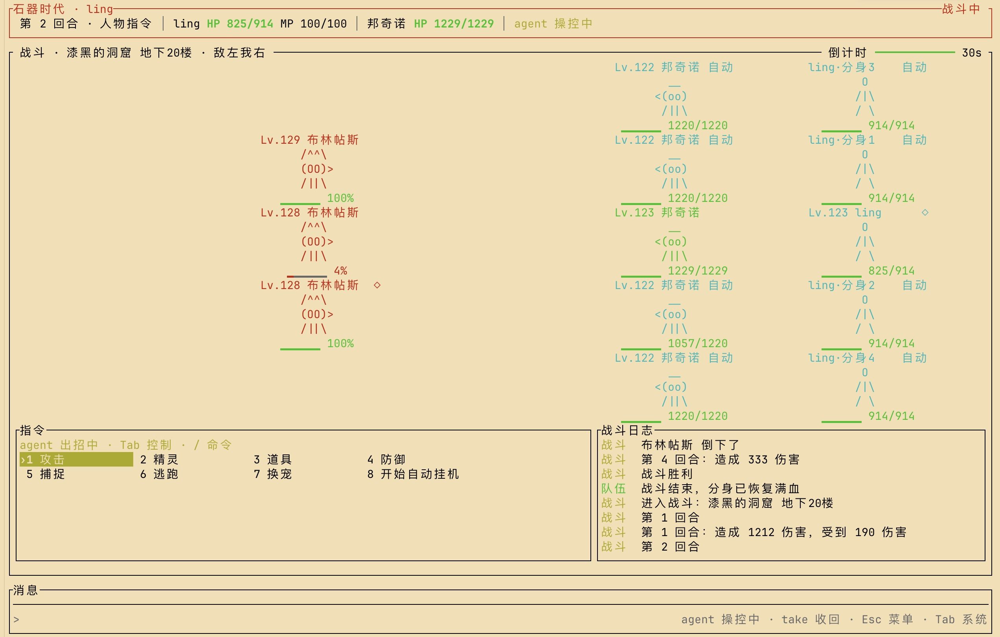

# 石器时代 2.5 · 命令行版

在终端里玩的石器时代 2.5：Rust（ratatui）命令行客户端 + Go 重写的服务端，两者之间使用自定义的 JSON Lines 协议，账号与角色数据存 PostgreSQL。

> 本项目是个人的非商业研究与学习作品，与原游戏的版权方没有任何关联。仓库不包含原版的美术素材、数据表和源码；需要它们的脚本和测试由使用者自备数据（见 [AGENTS.md](AGENTS.md)“原版数据与素材”）。



**只想玩**：不用编译，按 [docs/play.md](docs/play.md) 里的三步装好客户端即可（macOS / Linux / Windows）。下面是给想自己编译、跑服务端或改代码的人看的。

## 目录

| 目录 | 内容 |
| --- | --- |
| `client/` | 命令行客户端（Rust + ratatui）与模拟服务端 |
| `server/` | 游戏服务端（Go） |
| `cmd/` | 服务端、管理工具、协议测试客户端、MCP 服务、石器百科等入口 |
| `internal/` | 认证、MCP 会话层、石器百科等内部包 |
| `docs/` | 协议、界面、交互规范与各玩法的设计文档（从 `docs/protocol.md` 读起） |
| `demo/ratatui-demo/` | 界面风格基准（ratatui 官方 demo） |
| `scripts/` | 服务端启停、冒烟测试、客户端一键启动 |
| `tools/` | 数据生成与校验脚本 |

## 安装

### 只安装客户端（推荐）

不用编译，也不用装 Go / Rust。支持 macOS（Apple 芯片和 Intel）、Linux（x64）、Windows 10 / 11（x64）。装完重开终端，输入 `stoneage` 即可。

| 方式 | 命令 |
| --- | --- |
| macOS / Linux | `curl --proto '=https' --tlsv1.2 -LsSf https://github.com/athlan20/stoneage/releases/latest/download/stoneage-client-installer.sh \| sh` |
| Windows（PowerShell） | `powershell -ExecutionPolicy Bypass -c "irm https://github.com/athlan20/stoneage/releases/latest/download/stoneage-client-installer.ps1 \| iex"` |
| Homebrew | `brew install athlan20/tap/stoneage` |
| npm（Node.js 18+） | `npm i -g stoneage-cli`，或不安装直接 `npx stoneage-cli` |

升级用 `stoneage update`。每一步的图文说明、安装位置和常见问题见 [docs/play.md](docs/play.md)。

### 从源码安装（自己编译、跑服务端）

依赖：

- Go 1.25 以上（服务端）
- Rust 1.88 以上（客户端；`rustup` 安装，工具链在 `~/.cargo/bin`，非交互 shell 可能不在 `PATH` 里）
- PostgreSQL（本机装一个即可，服务端启动时自动建表）

```sh
git clone https://github.com/athlan20/stoneage.git && cd stoneage

# 1. 准备数据库（以 macOS Homebrew 为例，其他系统同理）
brew install postgresql@18 && brew services start postgresql@18
createuser --pwprompt stoneage          # 输入一个密码
createdb --owner stoneage stoneage

# 2. 配置：把 .env 里的 STONEAGE_DATABASE_URL 改成上一步的库和密码
cp .env.example .env

# 3. 编译并后台启动服务端（默认 127.0.0.1:7065）
scripts/server-start.sh

# 4. 编译并运行客户端，默认连本机服务端
scripts/client.sh
```

只想装出 `stoneage` 命令而不用脚本：`cargo install --path client --bin stoneage`。

Windows 上可以用仓库根目录的 `start-server.bat` / `start-client.bat`。服务端的停止、重启和状态查看见 [docs/server.md](docs/server.md)。

## 快速开始

已经按上面装好之后，常用命令：

```sh
scripts/server-restart.sh       # 重新编译并重启服务端
scripts/server-status.sh        # 查看服务端、数据库连接、表结构版本
scripts/server-stop.sh          # 停止服务端
scripts/client.sh --account alice   # 启动客户端并预填账号
```

只想看界面、不起服务端：

```sh
cd client
cargo run --bin mock-server -- --case register_ok
cargo run --bin stoneage        # 另开终端
```

更多命令、测试方法和代码结构见 [AGENTS.md](AGENTS.md)、[docs/server.md](docs/server.md)、[docs/client.md](docs/client.md)。

## 贡献者

见 [CONTRIBUTORS.md](CONTRIBUTORS.md)。

## 许可证

尚未选定。

## 推广

项目首发于 [Linux.do 社区](https://linux.do/)。
