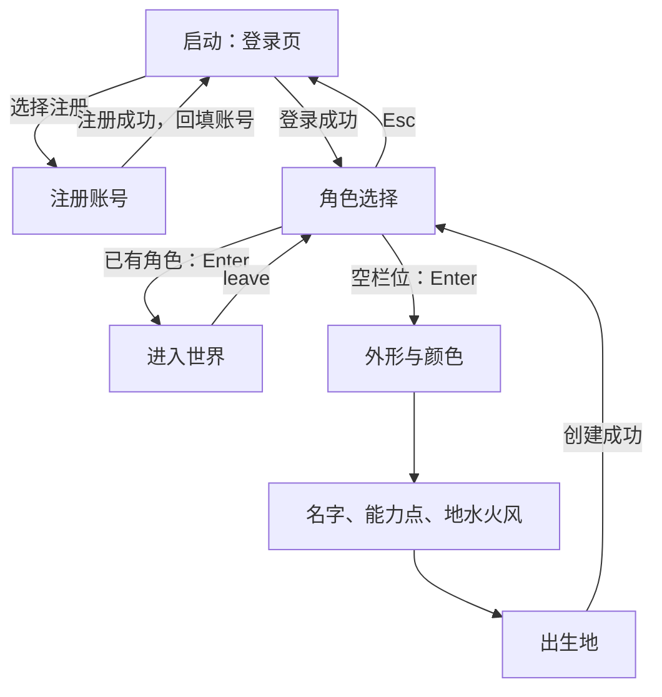

# CLI 改造前的交互梳理

核对日期：2026-10-16。基准提交：`30ff45a`。核对范围：改造前的 `client/src/app`、`client/src/ui`、交互规范及现有交互测试。

游戏主界面是 Rust + ratatui 的终端界面（TUI）。核心规则是：**进入世界后，输入焦点始终留在底部；空行用快捷键浏览，有字时编辑和执行命令。**

本文记录当前 Rust 客户端的行为，不是新设计规范。新的交互草案见 [CLI 交互调整方案](cli-ui-redesign.md)，可体验原型见 [client/html](../client/html/README.md)。游戏不需要手动行走，地点变化通过传送或直接对话实现。

## 从启动到进入游戏

登录、注册、选角、建角没有世界里的命令输入行，按表单规则操作：Tab / ↓ 下一项，Shift+Tab / ↑ 上一项；左右调整选项；Enter 确认。具体屏幕有少量例外，例如选角页用上下选择栏位、按 d 删除。删除角色必须输入完整角色名。

注册前会检查服务端是否开放注册；注册成功后回到登录页，不自动进入游戏。创建角色分三步：外形、名字与属性、出生地；成功后返回角色选择，再选择进入。登录页按 Esc 没有动作，其他表单页按 Esc 返回上一层。

## 进入世界后的固定布局

界面分成三块：

1. 顶部：角色名、等级、HP/MP 和 9 个菜单。普通标签绿色，当前菜单黄色。
2. 中间：当前页内容；NPC 对话覆盖页面；战斗时整个区域换成战场。
3. 底部：最近 5 条消息、分隔线、命令输入行。右侧灰字随当前页面、弹窗、战斗阶段或已输入的命令变化。

最低窗口为 80×24；更小时只显示窗口过小提示。任务攻略与百科详情在至少 110 列时并排显示，窄屏则替换列表，用 Esc 返回。地图侧栏也会随可用尺寸隐藏，Tab 只在实际画得出的栏之间切换。

## 9 个菜单的实际行为

| 菜单 | 当前内容与交互 | 空行 Enter |
|---|---|---|
| 1 地图 | 世界地图、玩家 @、地点 X编号；宽窗有当前位置和 NPC 表。Tab 在 NPC 和地点间切换 | NPC 填 `talk 编号`；地点填 `warp 编号` |
| 2 角色 | 基本信息、血蓝经验、能力、地水火风、精灵清单；Tab 切精灵/能力 | 能力有剩余点数时填 `addpoint 能力名`；精灵只查看 |
| 3 宠物 | 20 个栏位（一屏放不下时跟着选中行滚动），选中哪只就显示哪只的详情，跳过空栏位 | 一般填 `pet battle N`；出战或倒下的填 `pet rest N` |
| 4 背包 | 0–4 装备位、5–19 物品位；Tab 切物品/装备，选中项显示完整说明 | 按物品填穿戴、卸下、使用或移动命令 |
| 5 任务 | 编号、名称、状态；筛选进度，打开本地百科攻略 | 直接打开选中任务攻略 |
| 6 社交 | 仍显示“这一页尚未实现” | 无 |
| 7 消息 | 展开本次登录以来保留的消息，最多 1000 条；隐藏底部重复消息区 | 无；↑↓ 逐行滚动，End 最新 |
| 8 系统 | 服务端、账号、角色、操控方、显示模式、agent 令牌和命令说明 | 无；令牌通过命令管理 |
| 9 百科 | 分类 → 词条 → 详情，支持搜索；数据随客户端嵌入 | 进入分类或直接打开词条 |

系统页当前以信息展示、令牌与控制权管理为主，文档里设想的设置或重连不能一概理解为已存在的按钮。

## 最关键的分界：输入行有没有字

| 按键 | 输入行为空、无模态层 | 输入行有字 |
|---|---|---|
| 1–9 | 切菜单；0 无动作 | 输入数字 |
| ← → | 循环切菜单 | 移动文字光标 |
| ↑ ↓ | 移动列表选中项；消息页滚动；无列表时翻历史 | 按已输入前缀翻历史 |
| Tab | 切换当前页的选择栏，Shift+Tab 反向 | 补全命令和参数 |
| Enter | 打开详情，或先填好操作命令 | 执行命令 |
| Esc | 返回当前页的上一层详情 | 仅清空输入 |
| PgUp / PgDn | 列表跳一页、详情翻页 | 仍控制页面翻页 |
| Home / End | 列表首尾、详情首尾或消息首尾 | 移到输入行首尾 |

选中项以 `▶` 标记；当前接收方向键的栏中，选中行黄色反色；其他栏保留箭头与加粗。**切换选择栏不会把打字光标移出底部。** 每页记住自己的选择，切页或战斗返回后继续停在原处；换地图会重置地图页的选择。

字母通常总是打字。例如输入 `wa` 再按 ↑，只找以这个前缀开头的历史命令。战斗回放中空行按 f 切倍速是特例。

## 例子：穿上背包里的小斧头

第一次 Enter 不会穿上，只帮你填命令；你可以修改、Esc 清空，或再回车执行。普通页面上的操作遵守这条规则；任务攻略、百科词条这种查看行为则一次 Enter 就打开。

背包选中物品时：能穿且数量为 1 优先填 `item equip N`；否则能用的填 `item use N`；其余填 `item move N ` 等待补目标格。装备位填 `item unequip N`。

## NPC 对话与确认

`talk N` 发给服务端后，由服务端下发窗口标题、正文、选项及是否接受文字输入。

- 有选项时，空行数字键直接选择，对应 `choose N`，此时不会切菜单。
- 输入暗号或数量使用 `reply 文本`。
- Esc 遵守两步：有字先清空，空行再按关闭窗口。
- 字母仍能写进输入行；`page 背包` 可以切换弹窗底下的页面，弹窗状态仍保留。
- 无选项的窗口可在空行按 Enter 关闭。

丢物品、放生等确认使用统一方式：输入 `y`、`yes` 或 `是` 再回车；空行 Esc 取消。输入其他内容会取消确认，并继续把这行当普通命令执行。命令末尾带 `yes` 可以跳过询问，例如 `item drop 7 yes`。角色删除属于表单上的单独流程，需要角色名。

## 战斗是独立的交互场景

进入战斗后，顶部菜单换成回合与阶段信息，边框红色；中间显示敌我站位、血条、状态、战斗记录和目标详情。数字键用于战斗，`page` 也不能切页。

人物指令为：1 攻击、2 精灵、3 道具、4 防御、5 捕捉、6 逃跑、7 换宠；不满足条件的灰色显示。宠物阶段有自己的攻击、技能、防御指令。

同一操作可以用数字、方向键加 Enter，或命令（如 `attack e3`）完成。数字直选通常直接确认；需要目标的动作先进入目标选择，不需要目标的动作可以直接出招。因此不能把普通页面的“两次 Enter”套到战斗中。

精灵、换宠、技能按实际编号选择；道具编号是背包槽位 5–19，用 ↑↓ + Enter，不用单个数字键直选。选目标只能落在该动作允许的一方及可用单位上。列表里的 Esc 返回上层；宠物指令尚未提交时，可以退回并修改人物指令。

回放逐条表现行动者、目标、伤害或回复；Space 跳过，f 切倍速。战斗结果在空行按 Enter / Space / Esc 关闭；打字键也会关闭结果窗并保留该字符。关闭后返回战斗前页面。

## agent 与自动战斗

agent 操控时，界面显示“agent 操控中”。玩家仍可浏览、切页、查看详情，但修改游戏状态、选择对话选项和出招会被客户端拦截；`take` 收回控制权，`release` 交还，`ag 文本` 私聊。

自动战斗是另一项功能，`auto on/off` 开关。客户端自动选择动作；手动选择或打字会给玩家让位，暂停自动出招片刻，停止手动操作后继续。它与 agent 观察模式有不同的控制逻辑。

## 退出、反馈与边界

- `leave` 返回角色选择；`quit` 退出程序。世界里 Ctrl+C 第一次提示，连续再按一次才退出；其他屏幕 Ctrl+C 直接退出。
- Esc 不退出游戏，只清输入或退一层。
- 操作先经本地解析/校验、控制权检查，再交给服务端；服务端响应或推送更新状态，界面据此刷新，错误写消息栏。
- 当前以键盘为主：入口只处理按键事件，没有接入文档设想的 `--mouse` 开关与鼠标交互。部分终端可能把滚轮转换为上下键，列表选择会跟着移动。
- 仓库另有独立的浏览器百科 `internal/gamewiki/site`，用于公开资料检索，不是上述游戏主客户端；TUI 的第 9 页百科使用本地快照。

## 核对依据

- [全局交互规范](interaction.md)
- [主界面与各页规范](ui.md)
- [登录与创建角色](login.md)
- [主界面按键分发](../client/src/app/world.rs)
- [页面 Enter 的查看/填命令分流](../client/src/app/page_keys.rs)
- [主界面实际绘制](../client/src/ui/world.rs)
- [战斗按键实现](../client/src/app/battle/keys.rs)

初次梳理时运行了现有 8 组交互测试，共 113 项，全部通过，没有连接实际游戏服务端。样例画面与临时绘制工具保存在忽略目录 build/ui-guide/，不纳入代码仓库。
