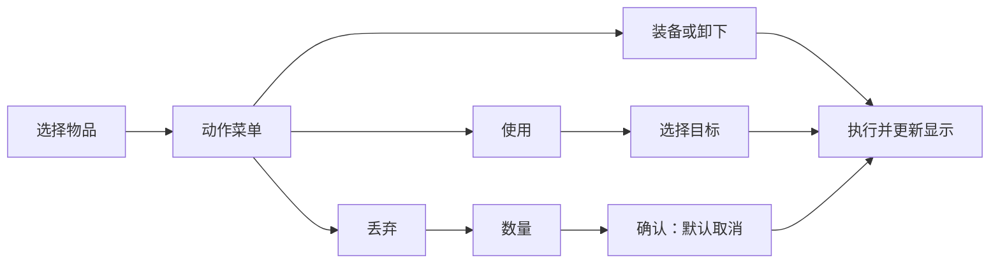

# CLI 交互调整方案与 HTML 体验原型

STAGE-148 场景页使用左右两列：左列为当前地图普通出口，末尾保留“传送到其他地点 / 查找并直接对话 / 回城”；右列为本图 NPC。默认左列，←→ 切列，↑↓、Home/End、PgUp/PgDn 只导航当前列，两列各自保存选择和滚动位置。Enter 对出口直接通过（不二次确认）、对 NPC 沿用直接对话；固定地点的原有流程仍保留。普通字母不输入，/ 命令、Esc 菜单及弹窗优先级保持。

出口显示目标名、代表触发坐标、格数、时段和单程标记。关闭或冲突的门仍显示，Enter 只说明原因。Tab 打开完整名字、所有触发格和不可用原因，↑↓/翻页阅读、Tab/Esc 返回；F5 重查焦点列。加载、失败可重试与确实为空分别显示，占位和分隔线不能执行。焦点标题带 * 且加粗，选中行带指示符，Unicode 关闭时改用 ASCII 指示符。80×24 保证两列、固定入口和完整信息入口可达。

进入、换图、重连刷新出口与 NPC；按服务端游戏时段到期重查出口。请求按响应 id、地图和位置/连接世代隔离；旧响应（含 A→B→A）不能覆盖当前地图。失败不冒充空列表，重连完整刷新前只读；连续 Enter 不重复使用出口。服务端返回权威位置后才换图，并停旧自动动作。数据、时段、权限、错误码见 [普通出口协议](protocol/exits.md)。


记录日期：2026-10-16。STAGE-131～140 已迁移到 Rust + ratatui；现行规则见 interaction.md、ui.md、login.md、battle-ui.md、system-menu.md 和 reconnect.md。本文保留原型设计依据。

## 已明确的目标与边界

说人话：让玩家像操作早期 DOS RPG、勇者斗恶龙式菜单一样，看到选项，用方向键选择、回车确认、Esc 返回，不需要先学会英文命令。

- 当前游戏运行在 CLI 窗口，未来还会有网页版和移动版。共用游戏动作、数据和规则，各平台分别设计界面与输入方式。
- **游戏不需要手动行走。所有地点变化都通过传送或直接对话实现。** 不规划方向键移动角色、局部地图走格子、寻路或碰撞系统。
- **先体验 HTML 假界面，交互确认后再改现有客户端。** 当前新增内容仅为文档和 `client/html/`，不修改 Rust 客户端、服务端或协议。
- 保留现有终端视觉基础：边框、具名颜色、高亮选中项、状态条、消息与地图概览。调整的是操作逻辑，而非先换一套画风。

改造前的行为见 [现有 CLI 交互梳理](cli-ui-current.md)。现行 [全局交互规范](interaction.md)、[主界面规范](ui.md)、[登录规范](login.md) 和 [战斗规范](battle-ui.md) 仍描述当前客户端；本文是候选方案，不直接替换它们。

## 从常驻命令行改为场景与菜单

| 方面 | 当前客户端 | 候选交互 |
|---|---|---|
| 默认焦点 | 底部命令输入行 | 当前场景、列表或菜单 |
| 操作入口 | 命令，或先填好命令 | 选择对象 → 选择动作 → 必要参数 / 目标 |
| 主菜单 | 顶部九个标签常驻 | 在场景根界面按 Esc 打开 |
| Enter | 打开详情或填命令，再回车执行 | 打开或确认当前选择 |
| Esc | 有字先清空，空行再返回 | 返回上一层；表单中取消本次编辑 |
| 文字输入 | 任意时刻都能打字 | 只有命名、搜索、数量、暗号、私聊等输入框接受文字 |
| 命令行 | 日常操作中心 | 按 `/` 打开的独立辅助入口 |

一次只让一个明确的区域接收操作。当前选中项用箭头和反色表示，底部提示当前层的按键。切换详情或弹窗后，返回时恢复上一层的选择。

## 场景与传送

场景根界面显示当前位置、角色状态、场景说明，以及当前地图可对话的 NPC。地图是位置概览，不承担手动行走。

```text
┌ 萨姆吉尔村 ──────────────────────┐
│ 小明 Lv12  HP 125/180  MP 45/80   │
├──────────────────────────────────┤
│ ▶ 村长                   任务    │
│   特产品贩卖员           商店    │
│   治疗师                 治疗    │
│   储存点                 存档    │
│   传送到其他地点                 │
│   查找并直接对话                 │
├──────────────────────────────────┤
│ ↑↓ 选择 · Enter 确认 · Esc 菜单   │
└──────────────────────────────────┘
```

- 选择地图里的 NPC，Enter 直接开始对话。
- 选择地点并确认，直接传送。
- 从任务或 NPC 目录直接对话时，如果不在同一地图，先提示目的地；确认后传送并自动打开对话。
- 不把整张地图的 NPC 列表误称为距离意义上的“附近 NPC”。
- 从场景按 Esc 打开游戏菜单，再按 Esc 回到场景；Esc 不直接退出游戏。

## 基本按键

| 按键 | 行为 |
|---|---|
| 方向键 | 选择当前对象、菜单动作、分类或战斗目标 |
| Enter | 进入、选择或确认；提交期间不重复发送 |
| Esc | 返回上一层，或取消当前输入；场景根界面打开游戏菜单 |
| PgUp / PgDn | 长列表、长说明翻页 |
| Home / End | 到列表或说明首尾 |
| Tab / Shift+Tab | 表单中切换输入框与按钮；命令栏内 Tab 补全 |
| `/` | 非文字输入状态下打开命令栏 |
| Ctrl+C | 保留退出保护，具体呈现以体验结果再定 |

不要求靠 Tab 切换多个隐藏焦点才能完成日常菜单操作。不依赖数字编号或字母快捷键；如果保留快捷键，应作为可见提示下的可选加速方式。

## 对象、动作、参数

普通操作不再生成英文命令让玩家再次执行。



| 页面 / 对象 | 交互 |
|---|---|
| 角色 | 状态、能力、精灵分类；选择能力后输入点数并确认 |
| 宠物 | 选择宠物 → 出战、待命、休息、改名、技能、放生 |
| 背包 | 物品 / 装备分类；选择对象 → 使用、装备、卸下、移动、说明、丢弃 |
| 任务 | 进度分类 → 任务 → 攻略或直接对话 |
| 百科 | 分类或搜索 → 词条 → 详情，Esc 逐层返回 |
| 消息 | 阅读历史，支持滚动与翻页 |
| 系统 | 控制权、令牌、自动战斗、遇敌、显示、连接、离开和退出 |
| 社交 | STAGE-162 起开放「队伍」一栏：没有队伍时一行入口「组成分身队」，有队伍时选成员 → 查看详情 / 解散队伍（确认默认取消）；名片簿、邮件、社交开关仍不做 |

常规动作在选择动作或目标后执行，不逐项重复问“确定吗”。丢弃、放生、角色删除等有损失的行为单独确认，默认取消；角色删除要求输入完整名字。

不可用动作保留显示并说明原因，例如宠物倒下、点数不足、MP 不足、背包已满。浏览背包时跳过空格；移动物品选择目的格时，空格应可选择，有物品时可交换。

## NPC、商店和文字输入

- 对话选项是可高亮的菜单，方向键选择，Enter 确认，Esc 返回。
- 暗号、宠物名字、搜索、私聊使用专门输入框，不要求输入 `reply`、`pet rename` 等命令。
- 商店：选择买卖 → 商品 → 数量 → 总价与确认 → 结果；取消不扣款、不移除物品。
- 输入无效时保留当前表单，说明错误；正确后再进入下一层。
- 购买、出售、使用等最终提交时再次验证目标、资源和数量，避免选择期间状态发生变化导致误操作。
- 正式实现应读取协议中的结构化选项与参数。现有协议表达不足时，先修改协议文档和契约用例，不能依靠猜测 NPC 正文来识别商品和数量。

## 战斗


- 方向键选动作或目标，Enter 确认；同时明确显示行动者、动作和目标。
- 不需要目标的动作可以直接提交；需要目标的动作在目标确认后提交。
- Esc 返回本地选择的上一层；宠物指令提交前，沿用现有协议允许的修改人物指令能力。已经提交的操作不能只靠本地返回假装撤销。
- 倒计时不会因菜单或命令栏暂停；超时按服务端规则处理。原型用防御补齐未提交指令，方便体验。
- 回放支持跳过和倍速，结果窗口由明确的“继续”关闭，普通字母不意外关闭结果。
- 自动战斗会为手动操作让位；自动战斗与 agent 控制权是两个独立状态。

## 命令、agent 与异常

命令栏继续提供历史、补全和帮助。关闭命令栏恢复原来的菜单与选择，保留未执行草稿。菜单和命令复用同一类动作及校验，不能各自实现一套业务规则。

agent 操控时可以浏览、看详情；会改变游戏状态的菜单动作与命令都被拦截，并提供可见的“收回控制权”入口。私聊、令牌、控制权管理按各自权限处理。

断线后允许阅读已有数据，服务器操作应给出连接错误；重连不清空已有本地视图。列表数据发生变化时按稳定标识恢复选择，目标消失则要求重新选择，不能把原动作自动套到另一项上。

## 多平台共用什么

| 行为 | CLI | 网页版 | 移动版 |
|---|---|---|---|
| 选择物品 | 方向键 | 点击 | 点按 |
| 打开动作 | Enter 菜单 | 操作菜单 | 底部动作面板 |
| 选目标 | 方向键高亮 | 点击目标 | 点按目标 |
| 返回 | Esc | 返回按钮 / 键盘 | 页面与系统返回 |
| 输入数量 | 数量表单 | 数字输入框 | 数字键盘 |

共用“对象、动作、目标、数量”和最终游戏规则，不强求共用窗口布局或按键。UI 收集意图，服务端负责最终合法性校验。

## 本次完成的原型

入口为 [client/html/index.html](../client/html/index.html)，使用说明和体验顺序见 [原型 README](../client/html/README.md)。

- 纯 HTML / CSS / JavaScript，相对路径加载同目录资源，无构建和第三方运行依赖。
- 可以用普通浏览器直接打开文件；本次内置浏览器体验使用本机静态预览服务，未发布到公网。
- 包含注册登录、两栏位选角、三步建角、名字确认删除，以及上述菜单、物品、宠物、任务、商店、传送、战斗、agent 和断线流程。
- 共享可变模拟状态，两个角色分别保存游戏进度。进度保存在当前浏览器，本地原型支持重置。
- 右侧的场景跳转是体验工具，不属于正式 CLI 设计；用于直接测试背包、商店、任务、战斗、观察模式和断线。
- 数值、奖励、战斗、假令牌和 agent 回复均为模拟。注册登录不做真实认证，也不模拟账号隔离，不应当作生产实现。
- 原型用于发现和确认交互问题，不等于上面的正式实现要求已经全部实现，例如真实网络在途状态和服务端推送一致性仍需正式客户端验证。

验证：`node --test client/html/prototype.test.cjs` 的 37 项测试通过，全部 JavaScript 通过语法检查；浏览器走通了装备、购买、跨图对话、暗号领奖、三步建角、战斗指令修改、观察拦截与接管、重连和命令入口，并检查了控制台错误。

## 后续落地顺序

1. 用户先体验原型，确认操作入口、返回层级、确认方式和场景流程。
2. 按反馈修订此方案与原型，再更新正式交互、页面、登录和战斗文档。
3. 在对应开发分支迁移 Rust 的导航与焦点机制，先完成背包作为纵向样板。
4. 迁移宠物、角色、任务、百科、NPC、商店，再统一战斗、命令与控制权行为。
5. 检查最小终端与宽窗的操作一致性、目标消失、重复确认、倒计时、断线和 agent 接管。

在用户确认前，不开始修改现有 Rust 客户端逻辑。
